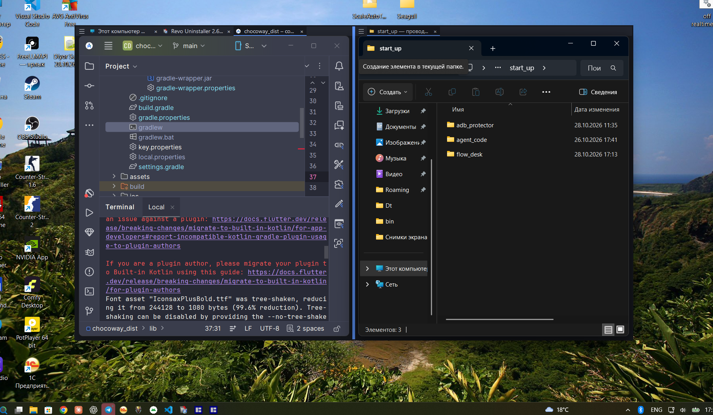
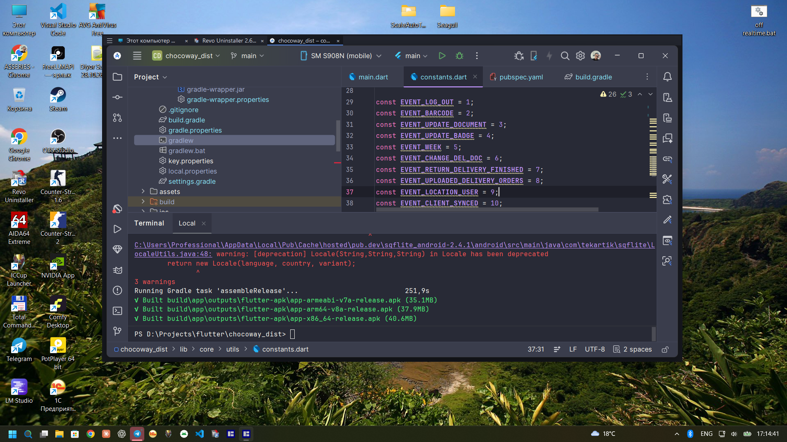
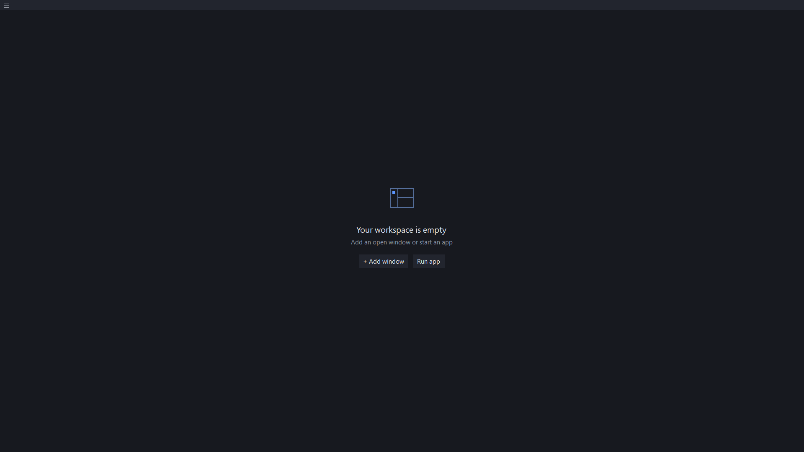

# Flow Desk

[](https://github.com/asseries/flow-desk/actions/workflows/build.yml)
[](LICENSE)


**Put real Windows applications into one workspace, with compact tabs and resizable split panels.**

Flow Desk manages live native application windows. You can type, click, scroll and use the original application directly. It is an early working prototype; compatibility depends on the target application and Windows build.

[Download portable build](https://github.com/asseries/flow-desk/releases/latest) · [O‘zbekcha qo‘llanma](docs/QUICKSTART_UZ.md) · [Compatibility](docs/VERIFICATION.md) · [Architecture](docs/ARCHITECTURE.md)

## Screenshots

### Two panels in one workspace



### Compact application tabs



### Dark empty workspace



Screenshots supplied by the project owner. Visible third-party applications are examples, not an exhaustive compatibility certification.

## Features

| Area | Available behavior |
|---|---|
| Workspaces | Multiple independent windows; create, rename, explicitly save and delete layouts. Temporary workspaces do not accumulate in saved history. |
| Panels | One or two panels; horizontal/vertical split; draggable divider; saved ratio; temporary panel expansion. |
| Tabs | Application icon/title, custom names, selection, drag reordering and Aligned-mode transfer between panels/workspaces. |
| Attach and detach | Search and multi-select running windows. **× detaches without closing the application.** Application close is a separate action. |
| Run app | Search Start menu shortcuts and Windows packaged apps, or choose an `.exe` / `.lnk`. Unique new matching windows can attach automatically; ambiguous/reused windows require selection. |
| Virtual desktops | Include other-desktop windows by default. Explicitly selected windows can be imported using the bundled local compatibility adapter and returned on detach. |
| Compact UI | Dark theme, a 24 px tab/menu row, no workspace caption, draggable empty header, resizable perimeter and an actionable empty state. |
| Full screen | F11 / menu toggles full-screen layout; host margins disappear and visible application frames align to outer monitor edges where supported. |
| Tray and startup | Background tray mode; normal repeated launch opens a new workspace; `--background` starts quietly and does not create duplicate windows. |
| Session and recovery | Saved layout metadata, conservative window matching, process/window identity checks, original window-state capture and an independent recovery guardian. |

## Quick start

1. Extract the portable ZIP from [Releases](https://github.com/asseries/flow-desk/releases).
2. Keep `FlowDesk.exe`, `FlowDesk.DesktopWorker.exe` and the **native** folder together. Run `FlowDesk.exe`.
3. Choose **☰ → Add window…**, select running windows and click **Add selected**. Start with **Aligned** mode.
4. Use **☰ → Split** to create a second panel. Drag the divider or tabs to organize the workspace.
5. Save a reusable layout with **☰ → Workspaces → Save workspace…**. Unsaved workspaces are temporary.

**☰ → Run app…** launches an installed application or an executable/shortcut. Closing a workspace restores its attached application windows and leaves Flow Desk in the tray. Use the tray menu or **☰ → Exit Flow Desk** to exit fully.

### Keyboard and window controls

- **Ctrl+Tab** — next tab; **F6** — next panel, while Flow Desk has keyboard focus.
- **F11** — full screen, while Flow Desk has keyboard focus. External applications keep their own shortcuts.
- Drag the empty part of the tab row to move the workspace; resize from the perimeter.
- Minimize, maximize/restore, full screen and close are in **☰**. No global keyboard shortcut is registered.

### Start with Windows

Press `Win+R`, open `shell:startup`, and create a shortcut to `FlowDesk.exe` with this target:

```text
"C:\path\to\FlowDesk.exe" --background
```

This starts only the tray icon. Click the icon or launch Flow Desk normally to open a workspace.

## Build from source

Requirements: Windows x64 and .NET Framework 4.8, including the framework C# compiler at `%WINDIR%\Microsoft.NET\Framework64\v4.0.30319\csc.exe`. A separate .NET SDK, Rust toolchain or NuGet restore is not required.

```powershell
.\build.ps1
.\dist\FlowDesk.exe
```

Build output includes the main application, isolated desktop helper, icon, native DLL and third-party license/provenance. The MIT-licensed native dependency and its source are vendored in `third_party/VirtualDesktopAccessor`; there are **no runtime downloads**.

### Tests

```powershell
# Headless model/session checks (also used by CI)
.\test.ps1 -ModelOnly

# Full suite: interactive Windows session and at least two virtual desktops
.\test.ps1
```

The full suite covers layout/session serialization, menu lifecycle, dark empty-state rendering, header drag routing, full-screen geometry, startup/single-instance behavior, native hide/show, application discovery/shortcut launch, and cross-process virtual-desktop import/attach/detach/restoration with disposable test windows. These tests do not certify every third-party application.

## Hosting modes and limits

**Aligned** is the default. It keeps each application's real top-level window and synchronizes it with panel bounds. Its native title bar, minimum sizes, menus and dialogs remain application-controlled. A window can enforce minimum dimensions or create independent popups, so Aligned mode is not a perfectly clipped child-window container.

**Embedded** is experimental. It changes parent/styles to place a compatible HWND inside the panel, rejects mismatched DPI awareness, and still requires application-specific validation. Embedded cross-panel moves and crash restoration are not universally supported.

The virtual-desktop adapter uses undocumented Windows interfaces in an **isolated local helper**, with DLL hash, HWND/PID/creation-time, session and desktop-GUID validation. Import and original-desktop restoration were tested on Windows 11 **26H2 build 26300.9711**. Windows updates, protected/elevated apps, removal of a desktop or destruction of an HWND can prevent operations. Failures are reported; the host does not terminate managed applications or change antivirus settings.

## Data and recovery

Settings and journals live in `%LOCALAPPDATA%\FlowDesk`. Only explicitly saved layouts persist. Matching metadata can contain executable paths and window titles; passwords, tokens and document content are not deliberately collected. Runtime HWND/PID values belong to recovery journals, not persistent layout identity.

The guardian restores still-valid windows after an unexpected host exit on a best-effort basis. It cannot recover destroyed embedded HWNDs or unsaved documents, and cannot guarantee restoration after power loss or termination of the entire process tree. See [architecture](docs/ARCHITECTURE.md) and [verification](docs/VERIFICATION.md).

## Contributing and license

[Contributions](CONTRIBUTING.md) are welcome. See [planned work](docs/ROADMAP.md) and [security notes](SECURITY.md).

Flow Desk is **MIT licensed**. Vendored dependencies retain their own notices: [LICENSE](LICENSE) · [Third-party notices](THIRD_PARTY_NOTICES.md).
